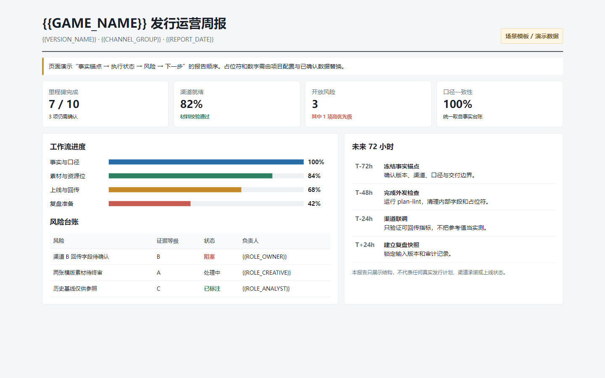

# 游戏发行运营 Skill 通用包

这是一套面向游戏版本与活动发行的工作方法库，覆盖用户研究、素材准备、渠道选择、运营方案、上线检查和复盘。每个 Skill 都写明触发条件、工作顺序和交付前检查。

仓库只提供通用方法和场景模板，不含真实游戏、客户、预算、KPI、内部链接、本机路径或人员信息。业务值使用 `{{占位符}}` 表示，数字仅用于演示。

> **场景模板**：随包示例用于演示游戏发行运营工作流；区域、服线、平台、渠道和项目字段均应先按 `01-占位符字典.md` 配置，示例档中的数值仅用于演示。`audience-insight` 中的采集脚本是可选适配器模板，必须由使用方按获准的数据源完成配置与字段映射。


项目自有文档、脚本、配置与合成示例按根目录 `LICENSE`（MIT）授权；未随包复制的平台内容或服务不因此获得授权。

## 报告预览

[打开完整 HTML 场景报告](examples/publishing-ops-report.html)



这份 HTML 用虚构状态演示事实锚点、执行进度、风险台账和下一步安排。它不代表真实发行计划或渠道承诺。

第一次使用不必通读全文。先看下面的工作链，再按当前任务跳到对应章节。

---

## 0. 工作链概览

### 这个包在工作链的哪个位置

```
一次版本 / 活动，从头到尾要干的活：

  [搞清玩家是谁] → [备素材和文案] → [定投放渠道] → [设计玩法奖品] → [排期上线] → [复盘收口]
        A               B                D                E              D · F           C
   └──────────────── 17 个 skill 分成 6 组，各管上面一段 ────────────────┘
              ↑ 全程由 _shared 里的红线 + F 组的自动校验兜底 ↑
```

字母就是包里 `skills/` 下的分组代号（A 用户研究、B 素材管理、C 数据复盘、D 投放、E 运营方案、F 校验与计算）。

### 三句话定位

| | 说明 |
|---|---|
| **它是什么** | 一套「方法 + 检查清单 + 可填空模板 + 可复用脚本 + **多智能体协作契约**」。每个目录里的 `SKILL.md` 是给 AI 助手读的作业指导书，写清「什么时候用我、按什么顺序做、做完自检什么」。 |
| **它不是什么** | 不是某个游戏的项目资料（包里**没有任何真实业务数据**）；不是开箱即跑的系统（脚本要你填自己的数据源和工具命令）；不绑定任何厂商的办公软件。 |
| **谁该用** | 游戏发行 / 渠道运营、市场投放、素材与内容运营、数据复盘岗；以及要把这套方法交给 AI 助手执行的团队。**不适合**只想找「一键生成方案」按钮的人——它的价值恰恰在于**先问清事实和口径，再动笔**。 |

### 三条最短路径

| 你现在的状态 | 直接去 |
|---|---|
| 不知道从哪下手 | `00-快速上手.md`，照着 5 步走 |
| 看到 `{{...}}` 不知道填什么 | `01-占位符字典.md`，每个占位符都写了「填哪类信息 + 例子 + 能不能外发」 |
| 想看填好之后长什么样 | `03-虚构示例.md`，用一款完全虚构的游戏把整条链路演示了一遍 |
| 只做用户研究 / 让多个智能体一起分析并出运营策略 | `skills/A-用户研究与用户分析/audience-research-ai/README.md`：六阶段工作流、六维结论卡、洞察转策略；**不进渠道方案主链路** |

---

## 1. 它能帮你干什么（作用）

### 1.1 核心作用：让「返工」不发生

这套东西最值钱的不是模板，是**顺序和纪律**。实践中最常见的坑是：返工几乎从来不是因为写错，而是**开始得太早**——事实没问清、口径没统一就开写方案，后面全要重写。

所以本包把三件事固化下来了：

1. **开工先问清，不许直接开写**（第 3 章的工作流）；
2. **数字要有出处、口径要能对齐**（`_shared/口径模板.md` + 红线）；
3. **出稿前自动体检一遍**（`plan-lint` / `prize-calc`）。

### 1.2 六个场景，对号入座

不用记 17 个 skill 的名字。看下面这张表，找到你眼下的活，直接把那句话对 AI 助手说，或者翻对应的 `SKILL.md` 人读。

| 我想做的事 | 用哪组 / 哪个 skill | 最后拿到什么 |
|---|---|---|
| 「玩家到底是谁、在聊什么、能分几群」 | A · `audience-insight` | 人群画像 + HTML 洞察报告 + 可对接方案的人群事实 |
| 「整理访谈 / 问卷 / 评论」「从数据里找运营策略」「让多个智能体一起做研究」 | A · `audience-research-ai` | 六维结论卡 + 证据等级表 + 可验证的策略清单（五元组 + 三档） |
| 「这波素材哪张有效、为什么、还差多少」 | B · `material-review` | 逐张打标表 + CTR 归因 + 复用衰减 + 缺口测算 + 复盘报告 |
| 「写个活动文案 / 给素材下个 brief」 | B · `content-brief` | 单条素材或内容的 brief / 文案 / 脚本 |
| 「找哪些主播、怎么谈、怎么披露」 | B · `creator-partnership` | 分层选人 + 合作模式 + brief + 披露合规 + 效果回收 |
| 「该投哪几家、优先级怎么排」 | D · `channel-selection` | 渠道组合方案 + 打分 + P0/P1/P2 分层 |
| 「出一版完整渠道方案」 | D · `channel-plan` | **主产出**：可提交的渠道方案文档 |
| 「排期、T-N 锚点、风险清单」 | D · `launch-plan` | 发行节奏与执行计划 |
| 「开工前先把事实和台账对齐」 | D · `channel-context` | 共享上下文台账（其它 skill 都要先读它） |
| 「向合作方收素材和资源位信息」 | D · `resource-requirement-table` | 内部「全景表」+ 对外「资源需求表」双交付物 |
| 「抽奖 / 任务链 / 奖品怎么配」 | E · `campaign-mechanic` | 活动机制：任务链 + 奖品结构 + 预算分配 + 效果预估 |
| 「社区日常怎么维护、负面怎么处理」 | E · `community-ops` | 社区运营节奏 + 舆情分级响应 |
| 「站内活动页怎么策划、逐屏怎么画」 | E · `activity-page-design` | 纯方案 + 独立对应参考文档 + 单文件 HTML 逐屏设计图 |
| 「这次活动效果怎么样、下阶段怎么调」 | C · `campaign-retro` | 结案复盘：口径回收 → 归因 → 三层结论 → 决策 → 回写 |
| 「泛泛地复盘 / 整理 / 总结 / 沉淀经验」 | C · `retrospective` | 弹性复盘框架（只 3 条硬底线，其余按情况裁剪） |
| 「发之前帮我检查一遍」 | F · `plan-lint` | 出稿体检报告，ERROR / WARN / INFO 三级 |
| 「算一下奖品表、预算超没超」 | F · `prize-calc` | 行价值 / 渠道小计 / 总盘子 + 结构约束校验 |

> 数量以包内实际目录为准。说不清用哪个时，把任务描述清楚，让 AI 助手按第 3 章的主链路自己串。

### 1.3 它替你挡掉的坑

这些是包里反复出现、脚本会真的去查的规矩：

- **不可比口径不相加**：不同渠道报的数字口径不一样，要相加先换算到统一口径。
- **证据等级必须标**：A 官方实测 / B 第三方或类比 / C 推测；B、C 不能当验收阈值。
- **不承诺渠道给不出来的指标**：写「渠道统计不到的人数」，等于逼出假数据。
- **原表只读**：别人给的原表 / 参考表一律只读，打标数据写进**新建**表。
- **对外 HTML 自包含**：图片内嵌、外部引用为 0，拷到空目录双击还能正常打开。
- **同一数据只维护一处**：正文、总表、备选清单里的同一数字，必须定死同步清单。

完整版见 `_shared/REDLINES.md`（第零章是「任何场景都不许改」的硬红线）。

---

## 2. 怎么用（用法）

### 2.1 三种姿势，任选

| 姿势 | 怎么做 | 适合谁 |
|---|---|---|
| **A · 交给 AI 助手（推荐）** | 把整个目录放进助手能读到的 skill 目录（常见是 `~/技能目录/` 或项目的 `技能目录/`）。助手遇到对应任务会自动匹配各 `SKILL.md` 里的 `description`。 | 想让 AI 按流程干活 |
| **B · 人读，当作业指导书** | 直接翻 `SKILL.md`；或把某份内容贴给任意 AI 当提示词。**包内不依赖任何专有加载机制**。 | 不想装 skill、只想查方法 |
| **C · 只跑脚本** | 在对应 skill 的 `scripts/` 目录下跑 Python，见 2.6 命令速查。 | 只想算奖品 / 体检方案 |

> 包内所有互相引用都用**包内相对路径**（例如 `_shared/REDLINES.md`、`skills/D-投放/channel-plan/`），所以整个目录可以整体搬走，不会出现「指向不存在文件」的死链。

### 2.2 第一次上手：5 步（全程不写代码）

| 步 | 做什么 | 花多久 |
|---|---|---|
| 1 | 把解压后的整个目录放到一个固定位置（助手能读到的地方，或项目根目录） | 2 分钟 |
| 2 | 复制 `_shared/config.example.yaml` → `_shared/config.yaml`，照 `01-占位符字典.md` 填。**最少填 8 项就能开工**：游戏名、节点性质、两条服线、版本名、活动周期、渠道家数与代号、表格工具、表格命令行（做用户研究再加 H 组 7 项） | 10 分钟 |
| 3 | 打开 `_shared/profiles/`，挑一个最接近的场景档 | 1 分钟 |
| 4 | 跟助手说：「按这个包，出一版 `{{VERSION_NAME}}` 的渠道方案。**先跟我确认事实锚点和口径，别直接开写**」 | — |
| 5 | 出稿后说：「发之前帮我检查一遍」，跑 `plan-lint`（有奖品表再加 `prize-calc`） | — |

**第 2 步的提醒**：预算、KPI、历史基线这些**先别填**，等口径定完再说，填早了会返工。

**第 4 步的验收点**：助手应该**先反问你三件事**，而不是立刻甩一份方案过来——
① 事实锚点（版本日期、内容、服线、节点性质）；② 每家渠道能回传什么指标（跳转类能不能埋点）；③ 约束（预算、奖池、审批窗口）。
如果它没问就开写，让它先读 `skills/D-投放/channel-context/SKILL.md`。

### 2.3 场景档是什么、怎么选

「场景档」＝**一套预设参数**，写清这类场景通常有哪些渠道、能回传什么指标、任务链怎么派生、价带和份数结构长什么样。包里 5 个：

| 档 | 什么时候用 |
|---|---|
| `base.json` | 拿不准，或要自己新建一个档的起点 |
| `channel_prebook.json` | 给外部渠道做资源置换、且处在**预约期**（本包默认档） |
| `channel_version_week.json` | 同上但处在**版本上线周** |
| `community_cps.json` | 只做社区 / CPS / 积分制 |
| `platform_resource.json` | 只做平台内资源位投放 |

> **硬红线不用选**——它在 `_shared/rules.json` 里，任何场景都一样。规则分三层（详见 `_shared/规则三层说明.md`）：
> ① **硬红线**＝任何场景都不许改；② **场景参数**＝必须随业务背景变；③ **历史基线**＝只参照、不作验收阈值。
> **别把某一个方案的数字写成全局规定**，这是实践中最常见的坑。

### 2.4 换项目必做：填占位符

1. 复制 `_shared/config.example.yaml` → `config.yaml`，按 `01-占位符字典.md` 分 A~I 组填值（项目标识 / 节点与服线 / 渠道与平台 / 数据与工具 / 环境与角色 / **内部口径** / 游戏本体事实 / **用户研究专用，做研究才填** / 模板中文填空位不用查字典）。
2. 「内部口径」那一组（预算、KPI、基线、样本量）**按需填、外发前删**。
3. 在 `_shared/profiles/` 选一个档，或复制一份改成自己的档，把中性演示值换成实际值。
4. 全包搜 `{{[A-Z]` 确认没有漏填的全大写占位符。

> 注意区分两种花括号：全大写 `{{GAME_CN}}` 是**要替换的占位符**；`{{主标题}}`、`{{屏名}}` 这类中文的是**模板故意留的文案填空位**，不用查字典（见 `01-占位符字典.md` 第一、十一章）。

### 2.5 依赖清单

| 依赖 | 用在哪 | 必需？ |
|---|---|---|
| Python 3.10+ | `plan-lint` / `prize-calc` / `material-review` / `audience-insight` 的脚本 | 跑脚本才需要；只读方法不需要 |
| **无（仅 Python 标准库）** | `audience-research-ai/scripts/` 的 5 个统计脚本 + `selftest.py` | 不联网、不装第三方包、不接外部模型接口 |
| `requests` / `scikit-learn` / `jieba` / `pandas` / `numpy` / `matplotlib` / `beautifulsoup4` | `audience-insight` 目录下的 `requirements.txt` | 跑人群洞察才需要 |
| Playwright + chromium | 论坛类公开页面渲染 | 可选；不装会自动跳过该数据源 |
| `{{TABLE_TOOL_CLI}}` | 读写在线表格（素材打标、资源需求表） | 可选；换成你团队的表格工具命令即可 |
| 在线文档 / 表格工具 | 交付物落地 | 可选；也可以只出本地 HTML / MD |

**不需要**：任何特定厂商账号、任何真实文档 ID、任何使用方项目的数据文件。

> 采集类脚本只采**公开可见内容**，务必遵守各平台条款、控制请求频率、别用主力账号。包内 `scripts/data/` 与 `scripts/output/` 是**空目录 + 说明**，真实抓取数据与报告不属于方法，不在包内。

### 2.6 命令速查

在**对应 skill 的 `scripts/` 目录下**运行（`channel_prebook` 等档 id 是包内真实存在的，可直接用）。下面 `<方案.html>` 里的尖括号表示「换成你自己的文件名」，不是命令的一部分；带 `{{...}}` 的按 `01-占位符字典.md` 替换后再跑：

```bash
# 出稿体检
python lint_plan.py <方案.html> --profile channel_prebook
python lint_plan.py <方案.html> <执行与风险.md>          # 多文件一起（锚点互认）
python lint_plan.py <文件> --summary                     # 只看摘要
python lint_plan.py <文件> --only error                  # 只看 ERROR
python lint_plan.py <文件> --external                   # 外发模式，加查脱敏
python lint_plan.py --list-profiles                     # 看有哪些场景档

# 奖品表计算与校验
python prize_calc.py prizes.csv --profile channel_prebook
python prize_calc.py prizes.csv --md out.md              # 结果写成 markdown
python prize_calc.py --demo                             # 跑内置示例（仅演示，不是真实奖品表）
python prize_calc.py --list-profiles

# 人群洞察：采集 → 聚类 → 报告 一条龙（在 audience-insight/scripts/ 下）
python -m wfci.cli all
python -m wfci.cli collect      # 只采集
python -m wfci.cli analyze      # 只聚类（需先采集）
python -m wfci.cli report       # 只生成 HTML 报告

# 通用 AI 用户研究（在 audience-research-ai/scripts/ 下，纯标准库）
python selftest.py
python data_contract.py     --input sample_data/comments.csv --out out/contract.json
python segment.py           --input sample_data/profiles.csv --by server_line --out out/segments.json
python theme_count.py       --input sample_data/comments.csv --lexicon sample_data/lexicon.csv --out out/themes.json
python sentiment_lexicon.py --input sample_data/comments.csv --lexicon sample_data/lexicon.csv --out out/sentiment.json
python strategy_lint.py     --input sample_data/strategies.csv --out out/lint.json

# 素材打标分析 / 资源需求表（占位符按字典替换后再跑）
python analyze.py --docid {{DOC_ID}} --sheet "{{打标表名}}"
python build_sheet.py --spec spec.json
```

> 脚本一律从 `_shared/rules.json` + 场景档取值，**不硬编码渠道名、金额、日期、渠道数量**；某类检查不适用时是**整组跳过**，不是报警。

### 2.7 遇到问题

| 现象 | 原因 / 处理 |
|---|---|
| 脚本报「找不到包」 | 没切到脚本所在目录；`python -m` 需要在包根目录跑 |
| 到处是 `{{...}}` | 还没填 config，或漏了全大写占位符；全包搜 `{{[A-Z]` 找出来 |
| 校验一直误报 | 多半是把某个方案的数字写进了全局规则；**改场景档，别改硬红线** |
| 论坛数据采集为空 | 需要 Playwright + chromium；不装会自动跳过该数据源，不影响其它源 |
| 报告里出现「版本已上线」 | 节点性质填错成版本周了；预约期禁用这类表述 |

---

## 3. 工作流（顺序不能跳）

> **v1.1 新增的前置步骤**：要「从数据里找运营策略」时，先跑 `audience-research-ai`（六阶段工作流），把六维结论卡和策略清单交给后面的渠道方案当输入；**用户研究在渠道方案之前**，不进线 A / 线 B 主链路，也不与 `audience-insight` 的聚类数字互相改写。

### 3.1 六字主线

```
事实 → 口径 → 目标 → 活动 → 奖品 → 排期
```

顺序一跳，后面全要重写。**动笔前必须问清三件事**：
① 事实锚点（版本日期、内容、服线、**节点性质：预约期 or 版本周**）；
② 渠道能回传什么指标（含跳转类能不能埋点）；
③ 约束条件（预算、奖池、渠道能力、审批窗口）。

### 3.2 主链路：写方案时 AI 自动串

```
【线 A · 渠道投放方案】向外部渠道做资源置换 / 导流

  channel-context   →  channel-selection  →  channel-plan  →  launch-plan
       (D)                  (D)                  (D)              (D)
   对齐事实口径          选渠道打分           出完整方案         排期与风险
                                                │
                                                ↓
                                      campaign-mechanic (E)
                                      设计任务链 + 奖品结构
                                                │
                    ┌───────────────────────────┼───────────────────────────┐
                    ↓                           ↓                           ↓
            content-brief (B)      creator-partnership (B)   resource-requirement-table (D)
             素材与文案 brief        达人合作与披露            向合作方收资源位信息
                    └───────────────────────────┼───────────────────────────┘
                                                ↓
                                        community-ops (E)  社区运营动作
                                                ↓
                              ┌─────────────────┴─────────────────┐
                              ↓                                   ↓
                        plan-lint (F)                       prize-calc (F)
                        出稿体检                            奖品表算术与结构校验
                              └─────────────────┬─────────────────┘
                                                ↓
                                      campaign-retro (C)  活动结束后结案复盘
```

```
【线 B · 站内活动页】触达已有玩家的站内玩法与页面

  activity-page-design (E)
        ├→ 纯活动方案（4 章 md）
        ├→ 独立对应参考文档（md）
        └→ 单文件零外链的 HTML 逐屏页面设计图
```

**两条线严格分开**（最容易混）：线 A 产出「方案 + 奖励表 + 外发 HTML」，线 B 产出「纯方案 + 对应参考文档 + 页面设计图」。
**两套奖品、两套 HTML、两套准则互不套用**；线 B 不套 `_shared/profiles/` 场景档。只共享 `_shared/REDLINES.md` 第零章的通用红线。

### 3.3 出稿前体检 + 自检七问

`plan-lint` 输出 **ERROR / WARN / INFO** 三级，**ERROR 未修完不要出稿**；`--external` 会额外查脱敏。自己也能过一遍：

- [ ] 有没有写「付费变强 / 氪金碾压」这类话
- [ ] 有没有官方居高临下的口气
- [ ] 两条服线的信息有没有混
- [ ] 每个数字有没有出处和口径
- [ ] **这个数渠道真的能回传吗**
- [ ] 这份是给内部还是给外部（外部要脱敏）
- [ ] 对方能打开、能看到图吗（HTML 要自包含）

### 3.4 三条常见岔路

| 你想做的事 | 走哪条 |
|---|---|
| 只改奖品 / 价格 | 直接 `prize-calc` → 回填表格；**别改正文数字不改表**（同一数据只维护一处） |
| 复盘上一期 | 先确认当期场景档，再 `campaign-retro`；**别拿参照游戏的 CTR 当使用方实测** |
| 做站内活动页 | 走 `activity-page-design`，**别套渠道场景档** |

---

## 4. 项目架构（包里都有什么）

### 4.1 三层结构总图

```
┌──────────────────────────────────────────────────────────┐
│ 第 1 层 · 入口文档（人读，先看这几份）                 │
│ README.md / 00 快速上手 / 01 占位符字典 / 02 脱敏对照  │
│ 03 虚构示例 / _未纳入清单                             │
└───────────────────────────┬──────────────────────────────┘
                            ↓ 查规则、集中填值
┌──────────────────────────────────────────────────────────┐
│ 第 2 层 · _shared 共享层（所有 skill 都依赖它）       │
│ 红线 REDLINES.md │ 机读规则 rules.json │ 场景档 profiles/ │
│ config.example.yaml │ context-template.md │ 口径模板.md   │
│ 改这里一处，等于改全部 17 个 skill —— 消除死链的关键  │
└───────────────────────────┬──────────────────────────────┘
                            ↓ 被引用
┌──────────────────────────────────────────────────────────┐
│ 第 3 层 · skills 执行层（AI 读 SKILL.md 干活）       │
│ A 用户研究 · B 素材管理 · C 数据复盘                  │
│ D 投放 · E 运营方案 · F 校验与计算   共 17 个 skill   │
│ 每个 skill = SKILL.md + references/ + assets/ + scripts/│
└──────────────────────────────────────────────────────────┘
```

### 4.2 完整目录树

```
游戏发行运营_Skill通用包_v1.2/
├── README.md                       ← 你在这里：总入口
├── 00-快速上手.md                   ← 5 步跑通第一个任务
├── 01-占位符字典.md                 ← 全包 {{...}} 的填写说明（重点）
├── 02-脱敏对照与使用边界.md         ← 原值→占位符对照、哪些不能外发
├── 03-虚构示例.md                   ← 虚构游戏把整条链路演示一遍
├── _未纳入清单.md                   ← 扩展指南：还能加什么
├── 04-分发版自检.md                ← 发出去之前的四零检查表
│
├── _shared/                        ← 共享层：所有 skill 都依赖，改一处动全身
│   ├── REDLINES.md                 ← 通用红线（内容 / 数据纪律 / 交付 / 现实边界线）
│   ├── 规则三层说明.md              ← 硬红线 / 场景参数 / 历史基线 怎么分
│   ├── rules.json                  ← 机读规则模板（已抽空真实游戏事实）
│   ├── profile_loader.py           ← 场景档加载器（支持 extends 继承 + 硬红线回填）
│   ├── config.example.yaml         ← 集中填值处（复制成 config.yaml 用）
│   ├── profiles/                   ← 5 个场景档模板
│   │   ├── base.json                    中性缺省
│   │   ├── channel_prebook.json        渠道 · 预约期（默认档）
│   │   ├── channel_version_week.json   渠道 · 版本周
│   │   ├── community_cps.json          社区 · CPS / 积分制
│   │   └── platform_resource.json      平台 · 资源位投放
│   ├── context-template.md         ← 业务台账模板（事实锚点 / 渠道台账 / 决策日志 / 坑归类）
│   └── 口径模板.md                 ← 统一可比口径清单（效果层 / 观测层 / 履约层 / 禁用指标）
│
└── skills/                         ← 17 个 skill，按 6 大领域分组
    ├── A-用户研究与用户分析/
    │   ├── audience-insight/       采集 → 聚类 → 人群画像 → 运营打法 → 对接方案
    │   └── audience-research-ai/   AI 多智能体用户研究：六阶段 / 六维 / 洞察转策略
    │       ├── agents/             10 张平台无关角色卡
    │       ├── references/         7 份工作流与纪律细则
    │       ├── templates/          六张交付物空表
    │       ├── examples/           虚构示例（六阶段走通）
    │       └── scripts/            5 个零依赖统计脚本 + selftest.py
    ├── B-素材管理/
    │   ├── material-review/        逐张看图打标、CTR 归因、复用衰减、缺口测算
    │   ├── content-brief/          内容选题与素材 brief
    │   └── creator-partnership/    达人 / 创作者合作与披露
    ├── C-数据复盘/
    │   ├── campaign-retro/         活动结案：口径回收 → 归因 → 结论 → 决策 → 回写
    │   └── retrospective/          通用「复盘 / 整理 / 总结」弹性流程
    ├── D-投放/
    │   ├── channel-context/        上下文台账：开工前的事实与口径
    │   ├── channel-selection/      选渠道：能力、人群重合、打分
    │   ├── channel-plan/           渠道方案主产出（含方案模板、渠道原型参考）
    │   ├── launch-plan/            排期、阈值、风险清单
    │   └── resource-requirement-table/  资源 / 素材需求表（向合作方收信息）
    ├── E-运营方案/
    │   ├── campaign-mechanic/      活动机制：任务链、奖品结构、参与路径
    │   ├── community-ops/          社区运营动作
    │   └── activity-page-design/   站内活动页：纯方案 + 对应参考文档 + 页面设计图
    └── F-校验与计算/
        ├── plan-lint/              出稿体检（含现实边界线检查）
        └── prize-calc/             奖品表计算与约束校验
```

### 4.3 根目录 6 份文档各管什么

| 文件 | 什么时候翻它 |
|---|---|
| `00-快速上手.md` | 第一次用，想 5 步跑通 |
| `01-占位符字典.md` | 看到 `{{...}}` 不知道填什么（**全包最重要的一份**） |
| `02-脱敏对照与使用边界.md` | 要把包发给别人、或要出外发版之前 |
| `03-虚构示例.md` | 想看填好之后长什么样 / 想看完整链路示例 |
| `_未纳入清单.md` | 想扩展新 skill 时参考 |
| `04-分发版自检.md` | 分发前核对「零真名 / 零真实数字 / 零内部迭代史 / 零内部路径」 |
| 本文件 | 想搞清整体作用、用法、工作流、架构 |

### 4.4 `_shared/` 共享层：三层规则机制

这是整个包的设计核心，也是「为什么换个项目不会到处误报」的原因：

| 层 | 放哪 | 能不能改 |
|---|---|---|
| ① 硬红线 | `rules.json` 的 `layers.hard` / `redline_words` / `delivery` | **任何场景都不许改**（内容红线、数据纪律、外发交付、算术） |
| ② 场景参数 | `profiles/*.json` | **必须随业务背景变**：渠道、平台、节点、预算、奖池、任务、口径、排期、脱敏 |
| ③ 历史基线 | profile 里的 `note` / `baseline_ref` | 只作参照，标 A/B/C 证据等级，**不作验收阈值** |

- `profile_loader.py` 是共用加载器：支持 `extends` 多级继承、子档只写差异、硬红线强制回填。
- **新增业务场景**：新建 `profiles/<id>.json`，`extends` 指向最接近的档，只写差异项；覆盖任何默认值都要在 `overrides_log` 写一条（日期 / 改了什么 / 从什么改成什么 / 为什么）。**覆盖理由写不出来，就说明不该改。**
- 脚本只读 `rules.json` + profile，不硬编码渠道名、金额、日期、渠道数量。

### 4.5 `skills/` 层：17 个 skill 清单

| 领域 | skill | 什么时候用 |
|---|---|---|
| A 用户研究 | `audience-insight` | 「玩家是谁、在聊什么、分几群」「做用户画像」「数据驱动运营」 |
| A 用户研究 | `audience-research-ai` | 「用户研究 / 用户画像 / 人群分层」「整理访谈·问卷·评论」「从数据里找运营策略」「让多个智能体一起做研究」 |
| B 素材管理 | `material-review` | 「素材复盘」「给素材打标」「素材效果分析」「复用还有没有效」「算素材缺口」 |
| B 素材管理 | `content-brief` | 写内容选题、给素材 / 文案下 brief |
| B 素材管理 | `creator-partnership` | 找达人合作、定合作披露与内容边界 |
| C 数据复盘 | `campaign-retro` | 「这次活动效果怎么样」「为什么没达标」「结案报告」「下阶段怎么调」 |
| C 数据复盘 | `retrospective` | 泛化的「复盘 / 整理 / 总结 / 梳理经验」 |
| D 投放 | `channel-context` | 开工前先把事实、口径、台账对齐（其它 skill 先读它） |
| D 投放 | `channel-selection` | 决定投哪几家、怎么排序、怎么打分 |
| D 投放 | `channel-plan` | **主产出**：出一版完整渠道方案 |
| D 投放 | `launch-plan` | 排期、T-N 锚点、阈值、风险清单 |
| D 投放 | `resource-requirement-table` | 向品牌方 / 市场 / 合作方收集素材与资源位信息 |
| E 运营方案 | `campaign-mechanic` | 设计任务链、抽奖机制、奖品档位、用户路径 |
| E 运营方案 | `community-ops` | 社区侧具体动作与节奏 |
| E 运营方案 | `activity-page-design` | 站内活动页怎么策划、逐屏模块怎么画、对应参考文档怎么写 |
| F 校验 | `plan-lint` | 「发之前帮我检查一遍」——出稿体检 |
| F 校验 | `prize-calc` | 奖品表算术与结构约束校验 |

### 4.6 每个 skill 内部长什么样

不是每个 skill 都有全部四类，但结构统一：

```
<skill-name>/
├── SKILL.md          ← 必读：用途 / 触发语 / 步骤 / 自检。开头 frontmatter 的
│                       description 就是 AI 助手用来判断「该不该用我」的依据
├── references/       ← 按需查的细则、术语表、避坑说明（不通读，用到才翻）
├── assets/           ← 可填空模板（方案骨架、HTML 线框、报告模板）
└── scripts/          ← 可执行脚本（.py）+ requirements.txt；data/ 与 output/
                        是空目录 + 说明，不含真实数据
```

> 维护时最容易漏的是 `references/` 和 `assets/` ——**模板里写死的东西照样会误导人**。

---

## 5. 五条通用红线（碰到就停）

1. **不可比口径不相加**：不同渠道报的口径不同，要相加先换算到统一口径。
2. **证据等级必须标**：A 官方实测 / B 第三方或类比 / C 推测；B / C 不能当验收阈值。
3. **声量 ≠ 人口**：写「X% 的玩家」必须带「讨论声量」限定。
4. **原表只读**：别人给的原表 / 参考表一律只读，打标数据写进**新建**表。
5. **对外 HTML 自包含**：图片内嵌、外部引用为 0；外发前确认已脱敏（预算、渠道权重、内部 KPI 拆解不外露）。

完整版见 `_shared/REDLINES.md`。

---

## 6. 脱敏与外发

### 6.1 本包做了什么脱敏

- **真名 → 代号**：游戏名、渠道名、平台名、研发方、对标游戏，全部换成 `{{...}}` 占位符。
- **实数 → 空白模板**：预算、KPI、历史基线表、人群 CTR、样本量，全部抽空；`profiles/` 里的数字是**中性演示值**，不是任何真实项目数据。
- **内部标识 → 通用说法**：文档 ID / 链接 / 本机路径 / 人名，全部替换或抽空；办公平台与命令行一律用 `{{TABLE_TOOL}}` 之类的通用名。
- **保留了什么**：**方法论参数**（样本 < 20 只给方向性结论、曝光加权 CTR、分批 80 条/批、7 个分析维度等）不是敏感信息，是方法本身，予以保留。

逐项对照见 `02-脱敏对照与使用边界.md`。

### 6.2 外发前必须再查一遍

即使包本身已脱敏，**你填进去的值**才是新的风险源。给渠道方、合作方或公开分享之前：

- [ ] 预算、单价、总盘子 → 删
- [ ] 各家渠道权重 / 资源位排序 → 删（商务信息）
- [ ] 内部 KPI 拆解、单客成本、预估模型 → 删
- [ ] 历史基线实测值、人群分层 CTR 实测 → 删或改成相对值（如「较上期 +X%」）
- [ ] 文档 ID / 内网链接 / 本机路径 / 账户名 / 真人姓名 → 删或换角色
- [ ] **全包再搜一遍：有没有残留的真实游戏名、平台名、渠道名、版本名、具体日期**
- [ ] 图片全部内嵌，HTML 外部引用为 0，单文件能打开
- [ ] 全包搜 `{{[A-Z]` 没有没填完的占位符

> 经验：**外发版用相对值，内部版才用绝对值**；报告里只写「口径说明」不写「口径数值」。

### 6.3 给接收方的说明（可直接复制）

> 这是一套游戏发行运营的工作方法库（用户研究 / 素材 / 投放 / 运营方案 / 复盘 / 校验），已做脱敏：不含真实游戏名、渠道名、预算、KPI、内部链接与任何业务数据。所有 `{{...}}` 是待填占位符，填写说明见 `01-占位符字典.md`。请按你自己的项目填值后再使用。

---

## 7. 维护纪律（接手人必读）

- **改了红线要回头扫所有 skill**：过期指针比没有更危险。同步顺序：`_shared/` → `rules.json` + `profiles/` → 各 `SKILL.md`（**含 `references/` 与 `assets/` 模板**）。
- **数字不写死**：具体值进场景档或 config，不进方法论正文。
- **两套真源不互相引用**：线 A 与线 B 的准则 / 复盘各自独立，只共享红线第零章。
- **整合资料禁止通读**：先建地图 → 按需取用 → 每步留痕。
- **改文件前先 grep 现状**：别照记忆改，也别照上一版改。
- **准则是真源，skill 只放指针 + 骨架**；冲突时改准则。
- **新增 skill**：新建目录 → 写 `SKILL.md`（用途 / 步骤 / 自检）→ 在本文件目录地图与清单里登记 → 检查引用无死链。

---

## 8. 使用边界与免责

- 本包是**方法与模板**，不含任何真实业务数据；填进去的数据由使用方自行负责。
- 人群洞察等采集脚本只可采集公开内容，使用前请确认符合目标平台条款与所在地法规。
- 对标游戏、价带、奖项等示例均为虚构或中性值，不构成商业建议。
- 包内 `{{...}}` 未替换前，脚本与模板**不能直接用于生产**。
- 扩展方向与未纳入的能力类型见 `_未纳入清单.md`；需要时可单独补。

---

## 9. 版本

| 版本 | 日期 | 说明 |
|---|---|---|
| v1.0 | `{{AS_OF_DATE}}` | 首版：方法脱敏、通用化、按 6 大领域重组，附占位符字典与虚构示例 |
| v1.0（README 重写） | `{{AS_OF_DATE}}` | README 按「作用 / 用法 / 工作流 / 项目架构」重排，面向接手人补了三层架构图、主链路图、命令速查与场景对号入座表；包内其它文件未改动 |
| v1.1 | `{{AS_OF_DATE}}` | 新增 `audience-research-ai`：AI 多智能体用户研究 skill（六阶段工作流 / 六维分析 / 洞察转策略 / 10 张角色卡 / 5 个零依赖脚本 + 自测），字典补 H 组 |
| v1.2（分发版） | `{{AS_OF_DATE}}` | **深度脱敏分发版**：清除全部真实游戏/平台/奖品名、真实实测数字、内部版本与迭代史、内部路径与溯源叙事；重写共享红线与页面边界等 4 份文件；新增 `04-分发版自检.md` |

> 建议每次换项目时**复制一份本包再改**，保留一份干净的原始模板。
